# PROTOTYPE — how is the derived number presented?

Throwaway. Answers [How is the derived number presented?](https://github.com/hermanno3005/Chalk/issues/98),
a ticket on [Map: Endurance — what to set on this machine](https://github.com/hermanno3005/Chalk/issues/88).

> **Archived.** This write-up and its screenshots live here; the runnable Swift source
> lives at the `prototype-endurance-detail` tag. See
> [`docs/agents/branch-lifecycle.md`](../../agents/branch-lifecycle.md).

> ## Verdict
>
> **A — one zone at a time, laid out like strength's screen (§5).**
>
> - **A row of zone buttons, `Z1`–`Z5`, at the top**, with the incline menu at its trailing
>   end on a speed erg. A zone with no line on this scope and incline is dimmed but can
>   still be tapped. The screen opens on the zone, duration and incline of your most recent
>   entry.
> - **The scrub readout below it.** One large intensity (`15.0 km/h`), a speed's pace under
>   it (`4:00 /km`), then `6:00 in Z4 · 164 bpm · 12 entries ›`. **The entry count is the
>   uncertainty.** No ± band is drawn.
> - **The zone line, 150 pt**, in the accent colour, a point on every duration, joined
>   by straight segments. **Scrubbing snaps to durations you have done**: nothing between
>   two points is a number you have held. The selection is sticky, as in §5.2.
> - **The duration axis is linear, fixed at 0–20:00** on every erg and zone, so lines compare
>   and switching zones never rescales the chart. **An entry longer than 20:00 is
>   stored but not drawn**, as strength stores reps above 12. Unlike strength, it floors
>   nothing, so it has no effect on the line.
> - **The y axis is framed to the data. A split is plotted upside down**, so harder is up on
>   every erg.
> - **No ghost.** [#102](https://github.com/hermanno3005/Chalk/issues/102) found no sound
>   model. The only stretch Chalk could draw roughly honestly is a stub past the longest
>   duration. It does not exist for a line that already reaches 20:00, and it can't be
>   drawn on a level erg.
> - **A zone with no line** shows text where the chart would be (`No Z4 on this machine
>   yet.` / `Nothing you've logged here averaged 158–169 bpm.`). Below that, up to two
>   lines quote the nearest zone above and below that does have a line, at the duration
>   closest to the selected one: `Z5 3:00 at 16.5 km/h — too hard`.
> - **The hint on a new machine** (§5.4, carried over) quotes the sibling's line at the
>   **zone, duration and incline of the sibling's most recent entry**: `No entries here —
>   6:00 in Z4 at 15.0 km/h · 1 % on Technogym Run · Urban Gym`. That is the same entry
>   the log sheet seeds its first row from. If that point has dropped out of the line,
>   no hint is shown.

## Run it

Check out the `prototype-endurance-detail` tag, open `Chalk/Chalk.xcodeproj` and run. The app
is rooted at `ErgDetailPrototypeRoot`. The black bar below the app has these controls:

- **‹ ›** switches between variants A–C.
- **erg pill**: Treadmill (speed and incline, gym-bound) → Rower (split, transferable) →
  BikeErg (watts) → Stairmaster (level, gym-bound).
- **dataset pill**: typical → first visit (reached Z5 only) → nothing logged → zones not set.
- **axis pill**: linear 0–20:00 → square-root 0–20:00 → log 0:30–20:00 → framed (linear).
- **ghost pill**: none → past the longest duration.

The zone lines are written out by hand as the derivation (ADR-0006) would return them,
with nothing computed from entries. Everything is in memory. The chrome (back, machine
qualifier, overflow, Log) is dead. Screenshots were launched as
`-prototype.variant A -prototype.erg treadmill -prototype.dataset typical
-prototype.axis "x: 0–20:00 linear" -prototype.ghost NO -prototype.zone 4`. `-prototype.zone`
opens A on a given zone.

## The three

| | Shape | Answer at the machine | Costs |
|---|---|---|---|
| **A — One zone** | §5 moved over: zone buttons, one big number, one line | one glance once you've picked a zone | the other zones are a tap away |
| **B — Every zone** | all lines on one 200 pt chart; scrub a duration, one row per zone | every zone at one duration | lines cross; busy at four zones |
| **C — Table** | no chart; durations down, zones across | every number at once | Z1 column nearly always empty; shape and out-of-order points vanish |

**A** treadmill · rower · first visit · a zone you never landed in

 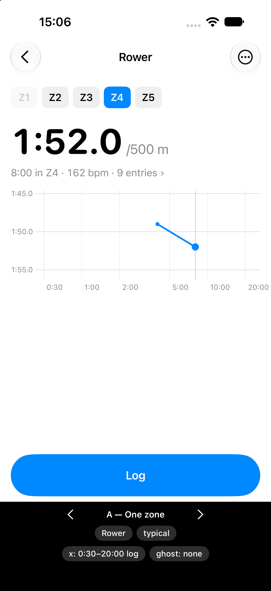 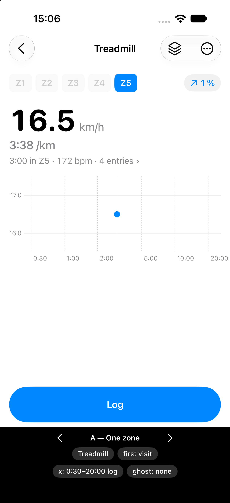 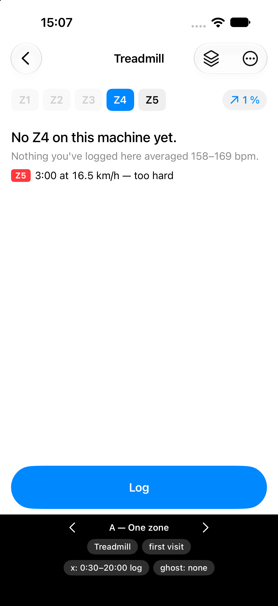

**B** treadmill · rower · BikeErg · first visit

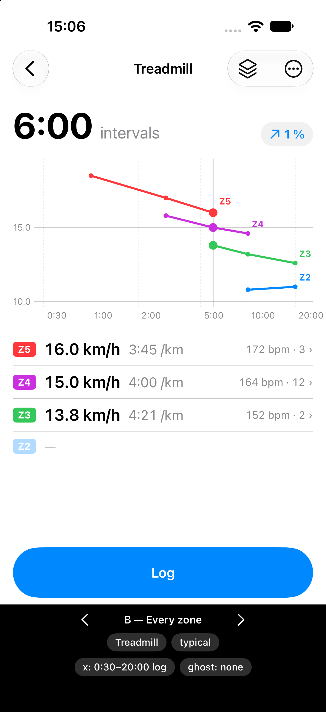 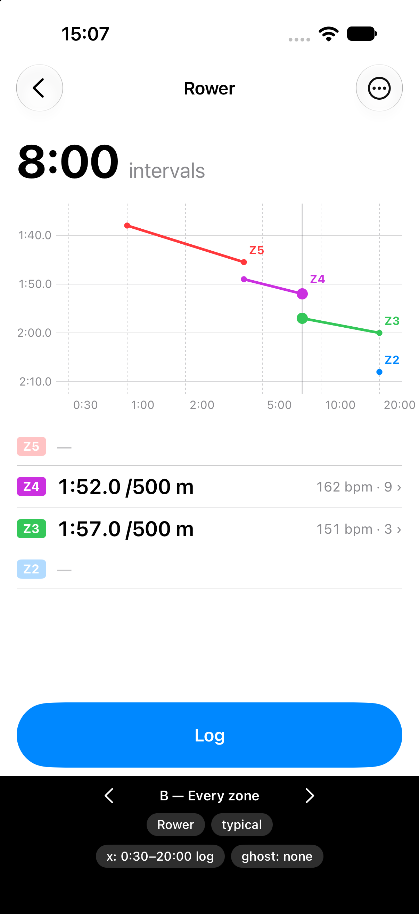 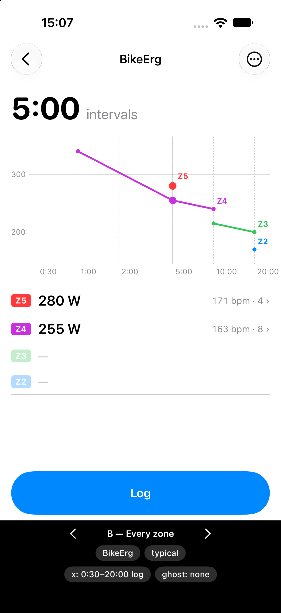 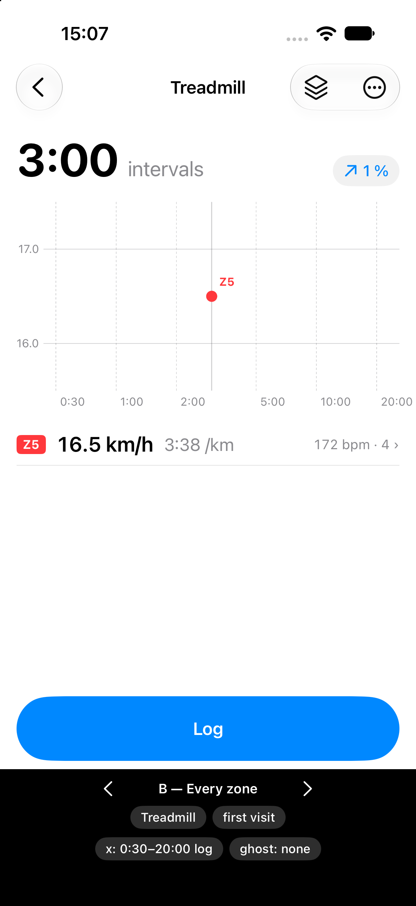

**C** treadmill · rower · Stairmaster · first visit

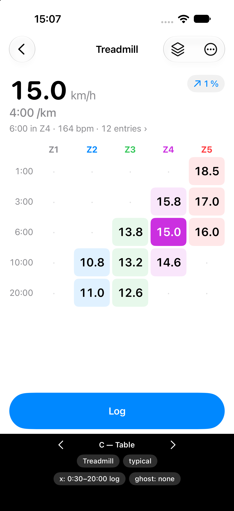 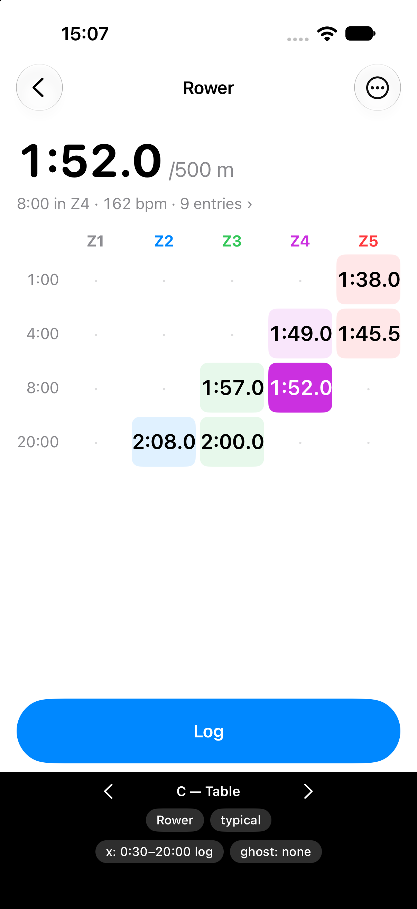 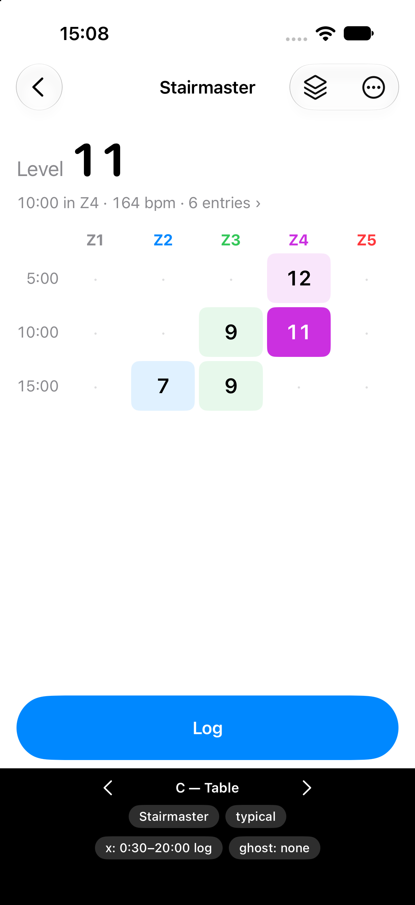 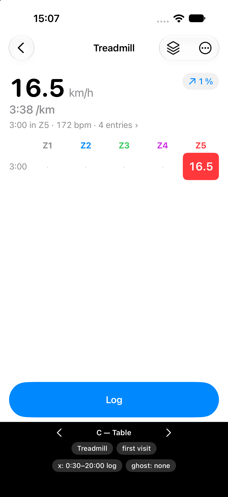

**Shared states** nothing logged, with the hint · zones not set

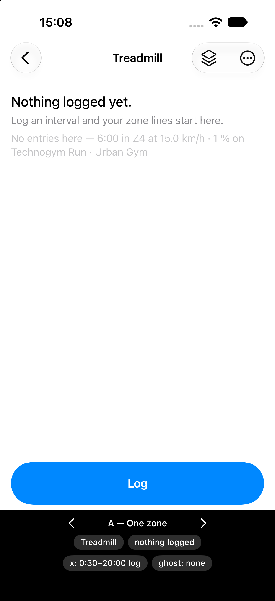 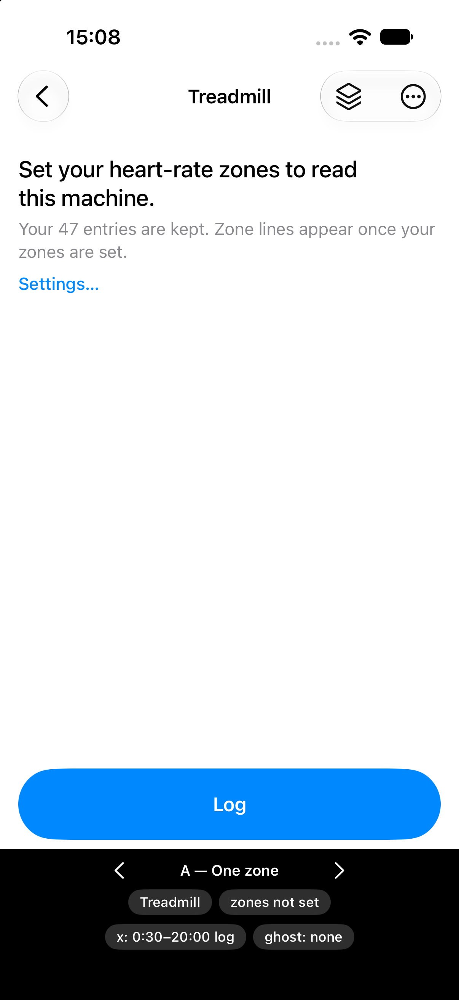

**The ghost** A · B

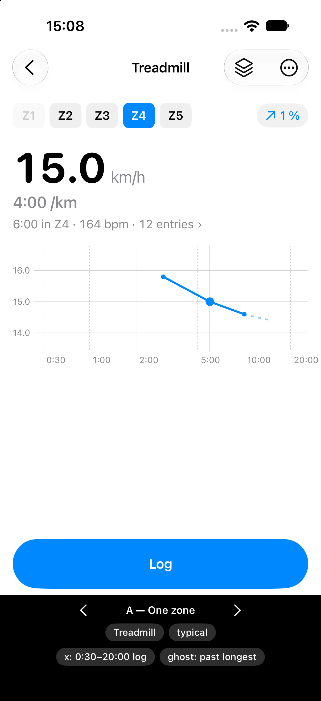 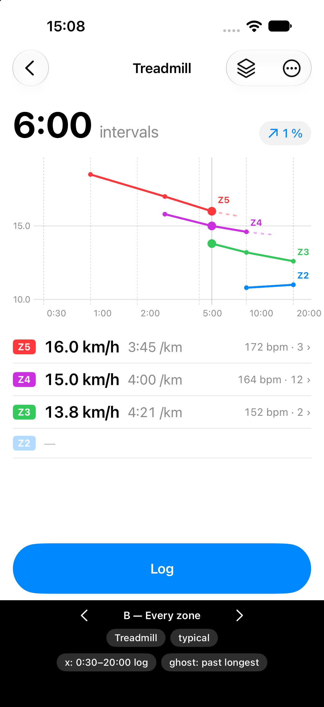

## What the screenshots show

The dev chose A. These are the differences the comparison turned up, not the dev's stated
reasons.

- **Only A says something useful about a zone you have never reached.** The first visit on
  a new machine often lands only in Z5. A shows Z4 as dimmed, and tapping it points at Z5 as
  too hard. B and C show a single dot or cell and nothing about the other zones.
- **B shows that short reps cross zones.** On the BikeErg, Z4 at 1:00 (340 W) sits above Z5
  at 5:00 (280 W): a short rep's average heart rate lags behind the effort. That's honest, but
  it reads as clutter, and only B puts two zones side by side where you'd notice it.
- **C is the easiest to read at arm's length, and it loses the line.** All the numbers
  are visible without dragging, but the Z1 column sits empty. An out-of-order pair (Z2
  10.8 at 10:00, 11.0 at 20:00) is obvious as a line and easy to miss in a table.
- **A split is plotted upside down.** Otherwise a faster rower line falls as it gets harder.

## Round two — the axis, on A alone

Round one used a fixed log axis from 0:30 to 20:00. The dev trains **mostly 4–15 minute
intervals**, and a log axis spends a third of the width on 0:30–2:00. So the treadmill's
sample lines moved into that range, and four axes were compared on Z4 and Z5:

- **Linear 0–20:00.** 4–15 minutes takes about 60 % of the width, and an occasional
  1:00 rep still shows at the left edge. **Chosen.**
- **Square-root.** It gains nothing: 4–15 minutes moves into the right half.
- **Log.** As above.
- **Framed (linear).** It fills the width, but the axis moves with the zone (Z4 ends at
  15:00, Z5 at 6:00). Tapping between zones rescales the line under your thumb, which
  undoes what the zone buttons are for.

Z4: linear · square-root · log · framed

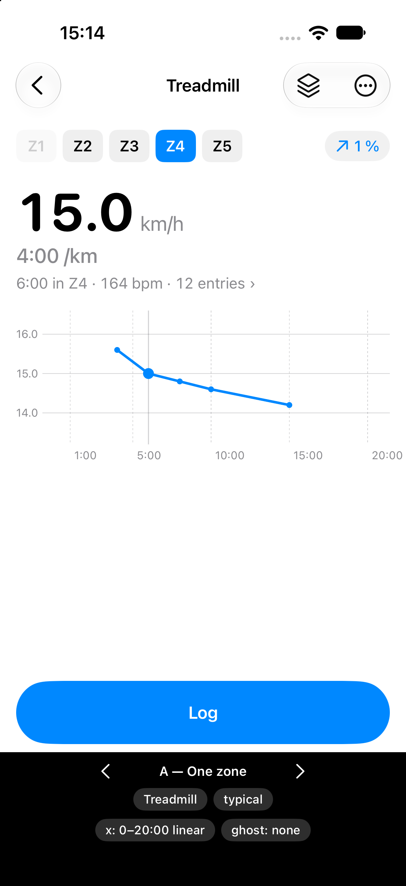  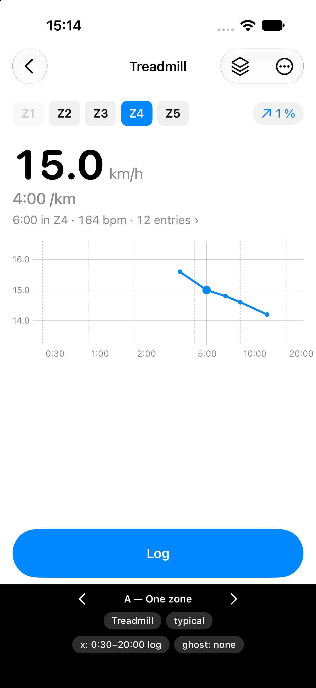 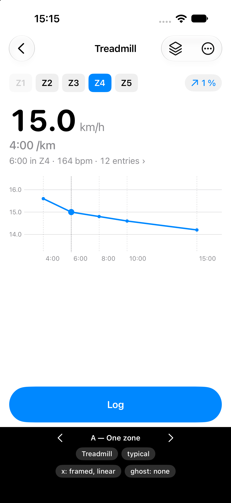

Z5: linear · framed

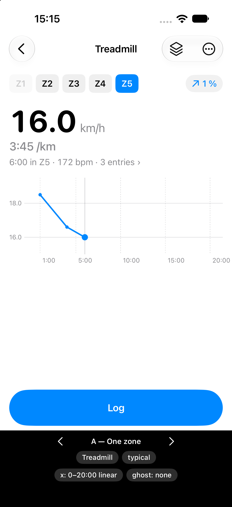 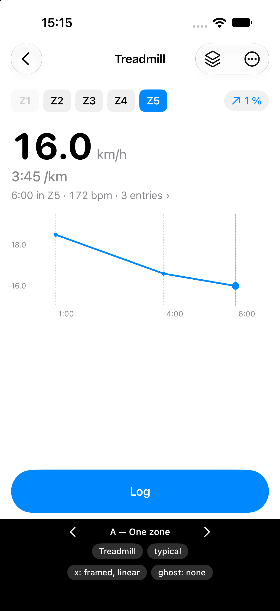

## Still assumed, not decided

- **The readout's `›`** is assumed to open the entries behind the selected point, as
  `best for N reps ›` opens §5.6's sheet. Where an erg's history lives belongs to
  [How is an erg's history reached, and an entry edited?](https://github.com/hermanno3005/Chalk/issues/103).
- **A goal line** under the readout, as §12.4 places one, belongs to
  [What is an endurance goal?](https://github.com/hermanno3005/Chalk/issues/99).
- **Zone colours** (Z1 grey, Z2 blue, Z3 green, Z4 purple, Z5 red; no orange, which §12.5
  keeps for goals) appear in A only on the zone tags next to the empty-zone text. A's line
  is drawn in the accent colour.
- **The empty states' copy** (`Nothing logged yet.`, `Set your heart-rate zones to read this
  machine.` with a *Settings…* link) is placeholder text.
