# PROTOTYPE — how do you get from strength to endurance on the home screen?

Throwaway. Answers [How do you get from strength to endurance on the home screen?](https://github.com/hermanno3005/Chalk/issues/96),
a ticket on [Map: Endurance — what to set on this machine](https://github.com/hermanno3005/Chalk/issues/88).

> **Archived.** This write-up and its screenshots live here; the runnable Swift source
> lives at the `prototype-endurance-home` tag. See
> [`docs/agents/branch-lifecycle.md`](../../agents/branch-lifecycle.md).

> ## Verdict
>
> **A segmented control, `Strength | Endurance`, stands where the "Chalk" title is now.**
>
> - **One tap, always visible on the home screen**, and the plainest way to say there
>   are exactly two halves. The "Chalk" title is gone.
> - **Sticky.** The app reopens on the half you last used. Strength on first launch.
> - **Each half has its own home screen**: its own resume card, search field (*Search or
>   add an erg* / *…an exercise*), `+`, and grid. Search never covers both halves.
> - **Shared by both halves**: the current gym (the same Gym menu in both overflows) and
>   *Settings…* ([How are heart-rate zones set?](https://github.com/hermanno3005/Chalk/issues/92)).
> - **The endurance side is §7's screen over ergs, groups included** (round two). The
>   suggested groups are `Treadmills / Rowing & Ski / Bikes`, with **Ungrouped** last.
>   They use §7.2's mechanics unchanged: asked at create, re-filed by drag or Arrange,
>   edited in Edit groups. **Each half has its own set.**
> - **One tile per erg.** A treadmill at four gyms is one *Treadmill* tile, and its
>   machine is picked inside, as a gym-bound exercise's is.

Built with two answers from the dev: they train strength and endurance **on separate
days**, so you switch halves about once a visit and reopening on the last half matters
more than switching fast; and the endurance library will hold **6+ ergs, including
ones of their own, at several gyms**, which is enough to want strength's grid and
search.

## Run it

Check out the `prototype-endurance-home` tag, open `Chalk/Chalk.xcodeproj` and run. The
app is rooted at `EnduranceHomePrototypeRoot`. The black bar at the bottom sits *below*
the app, not over it, so it never hides the search field or a tab bar:

- **‹ ›** switches between variants A–D.
- **dataset pill**: `18 + 9 ergs` → `18 + 3 ergs` → `18 + 0 ergs` → `9 ergs, lifted last`
  → `fresh install`.
- **on: pill** shows which half is persisted.

Strength is **the real `LibraryView`** over a seeded in-memory store, with a few prototype
hooks added to it (title, principal slot, title menu, overflow extras, resume override,
extra sections, extra results). Endurance is a stub made of plain structs, **the same in
every variant**: the variants disagree only about how you get there. Screenshots were
launched as `-prototype.variant A -prototype.dataset "18 + 9 ergs" -prototype.half Endurance`.

## The four

| | Switch | Taps | Costs |
|---|---|---|---|
| **A — Segmented control** | `Strength \| Endurance` in place of the title | 1 | the "Chalk" title |
| **B — Tab bar** | two native tabs | 1 | a second bar under the search field |
| **C — Title menu** | `Strength ⌄` is a menu | 2 | a small chevron you have to know about |
| **D — One library** | none: ergs are a section of the strength grid | 0 | one half always buries the other |

**A** strength · endurance

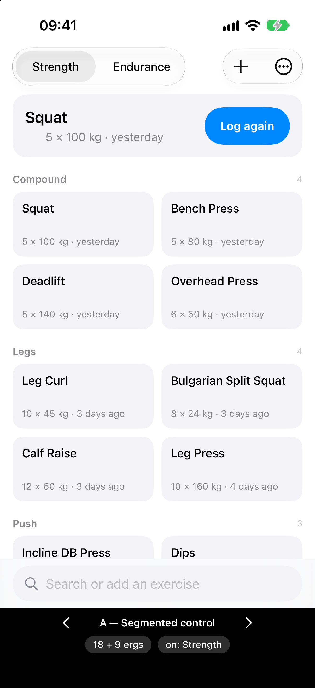 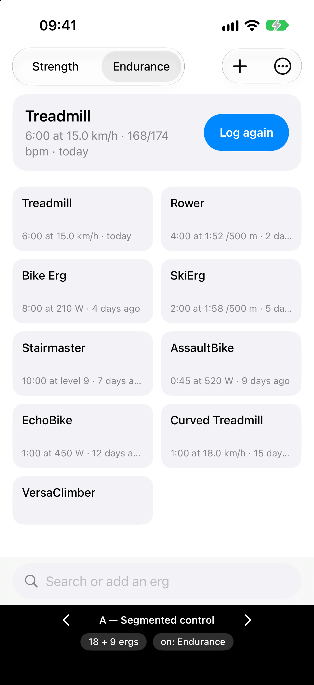

**B** strength · endurance

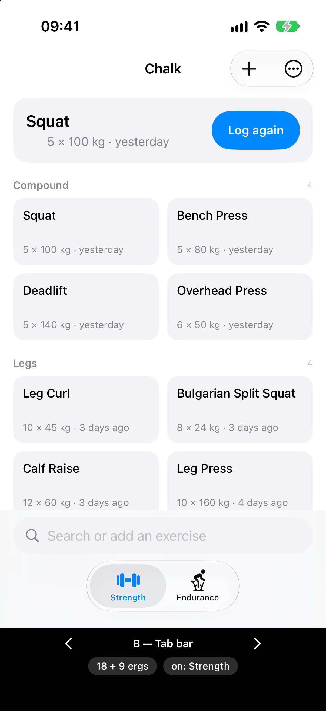 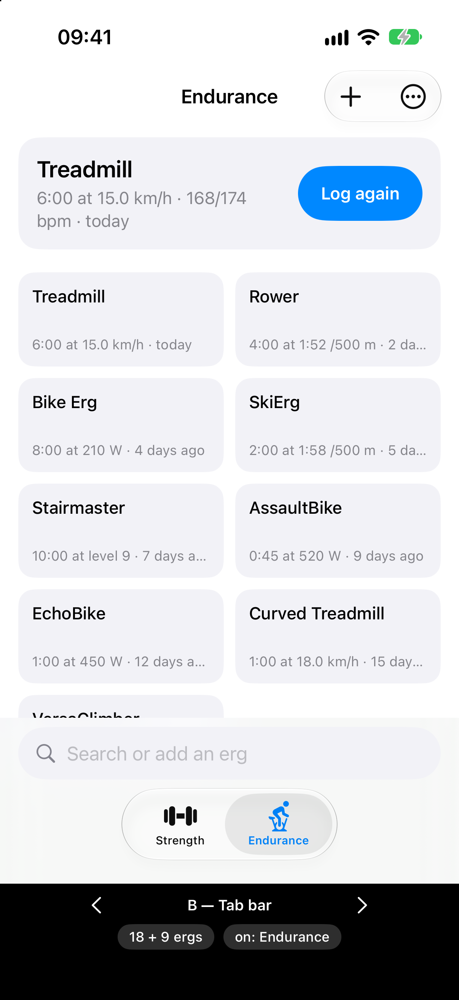

**C** strength · endurance

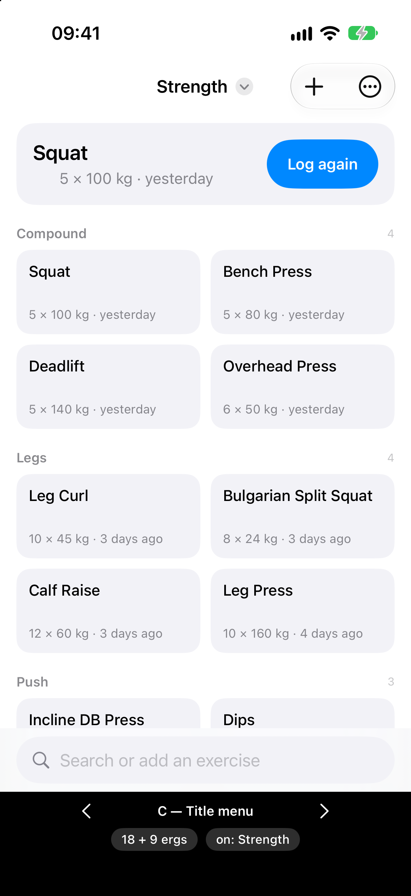 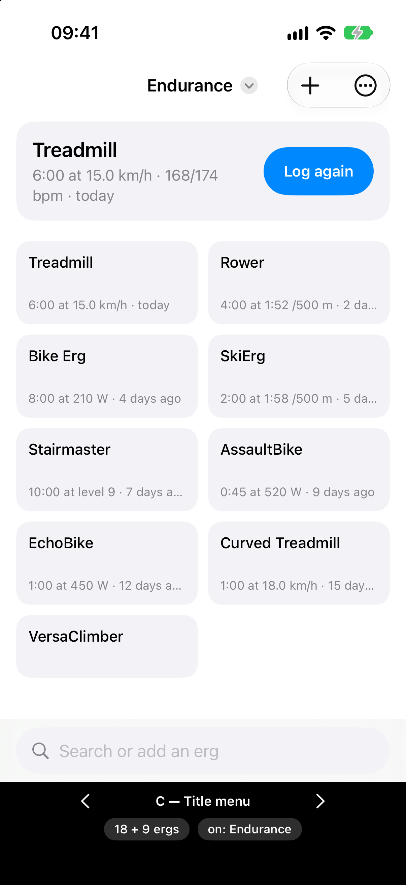

**D** ergs logged last · lifted last

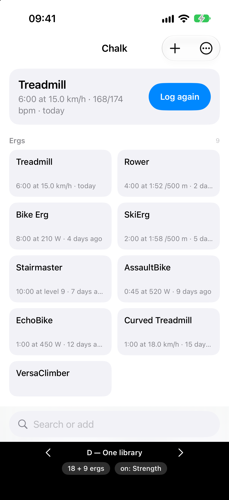 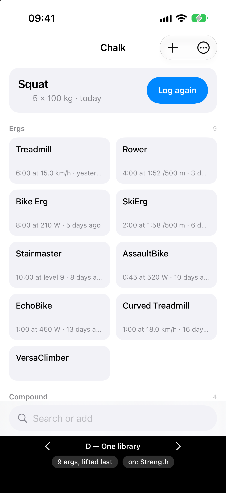

**The endurance side** at 3 ergs · with none

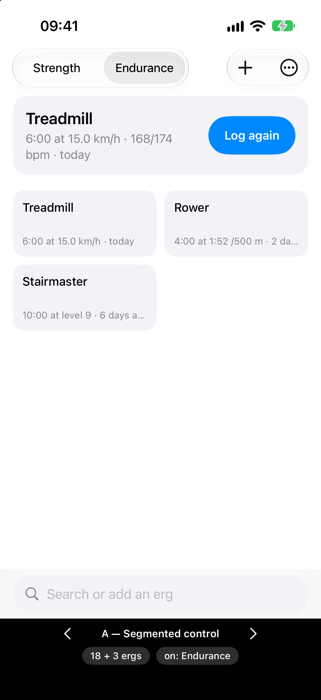 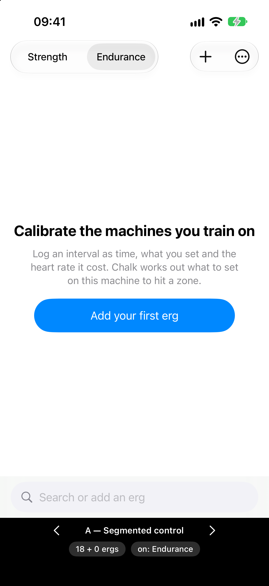

## What the screenshots settle

- **D fails the separate-days pattern.** On a strength day (`d-lifted-last`), nine erg
  tiles sit between the resume card and Compound, and strength starts below the fold.
  Putting Ergs last instead buries them under 18 lifts on an endurance day. With one
  shared grid, one half is always in the way. *Create it* also turns ambiguous: create an
  exercise or an erg?
- **B stacks two bars at the bottom.** The search field and the floating tab bar
  together take about one row of tiles, in exactly the thumb zone §7.1 gave to search.
  B's real advantage, each tab keeping its own navigation stack, is worth little when the
  switch only ever happens from the home screen.
- **C costs nothing on screen and is the hardest to find.** Its strength screen matches
  today's in everything but the title word. The dev chose A: they want the switch to be
  visible.
- **A only appears on the home screen**, because the control sits in the root's title.
  You never switch from a detail screen, so nothing needs to remember where you were in
  the other half. Switching always lands on that half's home screen.

## Round two — the endurance side gets groups

The dev kept everything about the endurance side except one thing: they want groups,
*"maybe treadmills, Ergs (Ski, Row, etc), Bikes, Other"*. Grilling sharpened that list in
three ways:

- **Not "Ergs".** In the glossary, *erg* means every endurance machine, the treadmill
  included, so a group named Ergs in the erg library would read as *all of them*. It is
  **Rowing & Ski**.
- **Not "Other".** **Ungrouped** is already the catch-all, and it sorts last. A seeded
  *Other* would give the library two catch-alls. Stairmaster and VersaClimber stay in
  Ungrouped until you file them.
- **The same mechanics as strength, with a separate set per half.** §7.2 is reused
  whole. An erg never sits in *Push*.

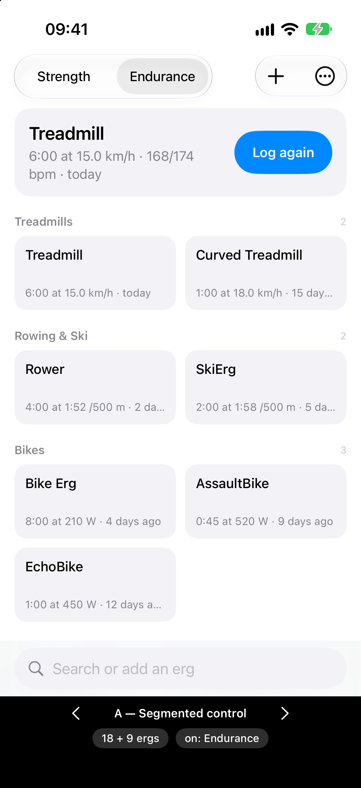 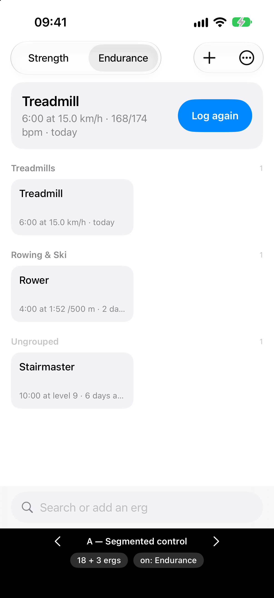

As with strength, **groups do nothing at three ergs** (`r2-three`): each is a header over a
single tile. That cost is accepted, as it was for strength.

## Still assumed, not decided

- **Tile and card wording** (`6:00 at 15.0 km/h · today`; on the card,
  `… · 168/174 bpm · today`) is a placeholder for
  [How is an interval logged?](https://github.com/hermanno3005/Chalk/issues/97) and
  [How is the derived number presented?](https://github.com/hermanno3005/Chalk/issues/98).
- **The endurance resume card carries no goal slot.** What an endurance goal is belongs to
  [What is an endurance goal?](https://github.com/hermanno3005/Chalk/issues/99).
- **Whether an erg comes preset** (and so whether the suggested groups start with
  anything in them) is [Does the endurance library start empty?](https://github.com/hermanno3005/Chalk/issues/104).
- **The erg detail screen and the log sheet are stubs**, there only so their placement can
  be judged.
