# PROTOTYPE — how is an interval logged?

Throwaway. Answers [How is an interval logged?](https://github.com/hermanno3005/Chalk/issues/97),
a ticket on [Map: Endurance — what to set on this machine](https://github.com/hermanno3005/Chalk/issues/88).

> **Archived.** This write-up and its screenshots live here; the runnable Swift source
> lives at the `prototype-endurance-log` tag. See
> [`docs/agents/branch-lifecycle.md`](../../agents/branch-lifecycle.md).

> ## Verdict
>
> **C — a grid shaped like the watch's lap list.** One sheet takes a whole block.
>
> - **One row per entry**, with columns in the watch's order: `Time | km/h | % | Avg | Peak`
>   on a speed erg, and `Time | <unit> | Avg | Peak` on the others. Saving writes **one
>   entry per row**, and nothing groups them afterwards. The rows are a way of typing,
>   not a session.
> - **The first row is seeded from your most recent entry** on this erg or machine (§6.3).
>   **Each new row is seeded from the row above.** Typing on a cell replaces its seed.
> - **One keypad, always up.** No steppers. *Next* walks the cells left to right. At the
>   end of the last row it becomes *New row*. A heart rate's last digit and a speed's
>   tenth move on by themselves.
> - **The zone of the focused row's average shows on one line under the grid**, e.g.
>   `Z4 · 158–169 bpm`. Nothing shows per row. Without zones set, the line is blank.
>   Logging never needs zones (ADR-0005).
> - **Delete a row from the row itself**: a red minus at its end. The last remaining row
>   has none, because Cancel is how you log nothing.
> - **Cancel asks once anything is typed**: *Discard 5 entries?* Swipe-down is off while
>   the sheet is touched. An untouched sheet just closes.
> - **Save reads `Save 5`** and stays off until every row is complete. A row whose peak is
>   below its average has those two cells outlined in red, and the line under the grid
>   says why.
> - **The machine caption (§6.4) appears once, above the grid**, and covers every row.
>   A transferable erg carries none.

Built with three answers from the dev:

- they log **after the block**, typing it from the watch's lap list, not in each rest;
- **nothing follows a pattern** from one interval to the next, so a seed rarely
  survives whole;
- the watch shows **average and peak on one screen**.

The host screen therefore shows a block **as the watch's lap list shows it**, with rests and
the warm-up left in. The job being judged is transcribing that list.

## Run it

Check out the `prototype-endurance-log` tag, open `Chalk/Chalk.xcodeproj` and run. The
app is rooted at `EnduranceLogPrototypeRoot`. The black bar sits below the app:

- **‹ ›** switches between variants A–C.
- **erg pill**: Treadmill (speed and incline, gym-bound) → Rower (split) → BikeErg
  (watts) → Stairmaster (level, gym-bound).
- **verdict pill**: no verdict → zone → vs the line.
- **save pill** (A and B only): closes → stays open.
- **the tally line** counts taps, sheet opens and entries saved, so the variants can be
  compared on the same block.

Everything is in memory: plain structs, with no SwiftData. Screenshots were launched as
`-prototype.variant C -prototype.erg Treadmill -prototype.verdict zone -prototype.autoOpen YES
-prototype.prefill 4 -prototype.focus average`.

## The three

| | Shape | Treadmill block of 4 | Costs |
|---|---|---|---|
| **A — Staged** | §6 whole: one giant number per field, steppers, tap for keypad, earlier answers as header capsules | 5 stages × 4 sheets | four sheet opens; 5 stages is too many for one entry |
| **B — Sentence** | the written form is the editor; every number tappable; keypad always up | 1 screen × 4 sheets | still one sheet per lap |
| **C — Lap list** | a grid shaped like the watch's lap list; one row per entry | 1 sheet | §6.7's "no run of entries to batch" no longer holds for endurance |

**Host** — the block on the watch

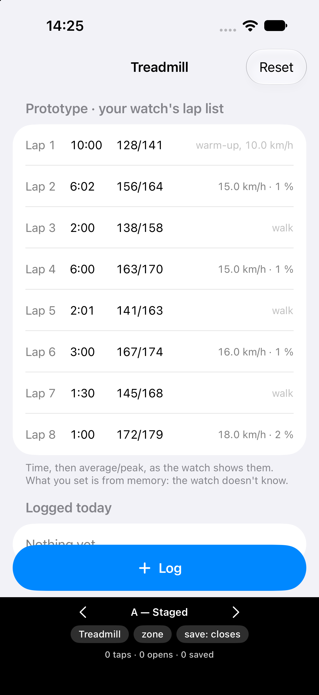

**A** duration · speed with the keypad · average heart rate

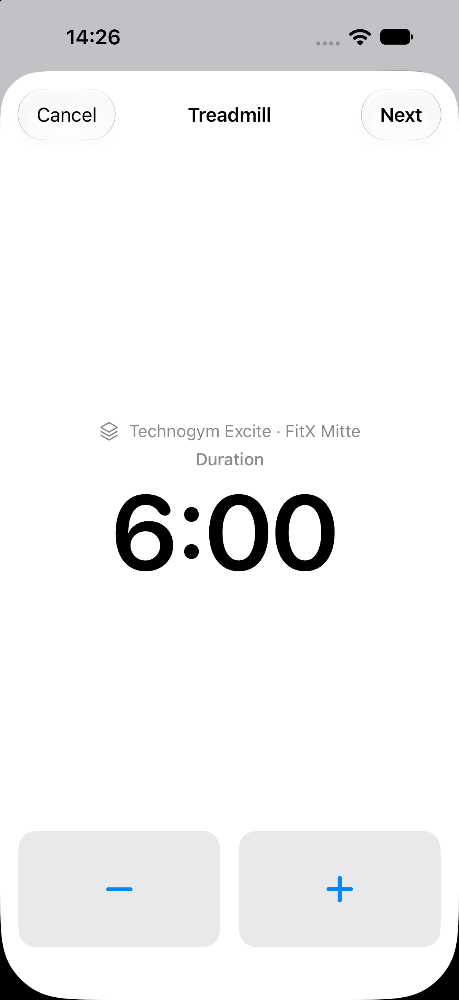 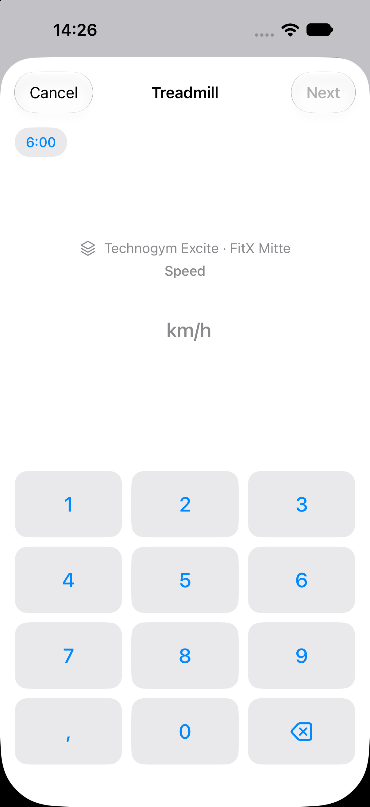 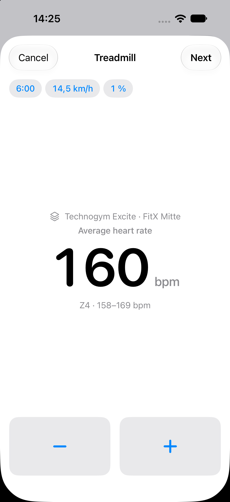

**B** treadmill · against the line · rower · Stairmaster

 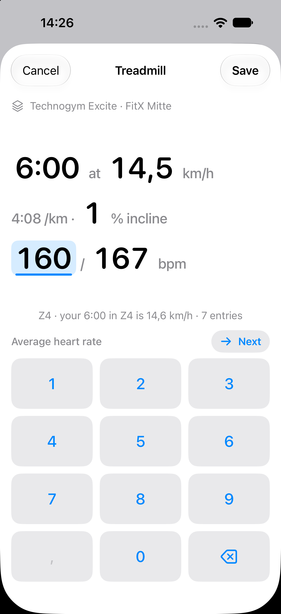 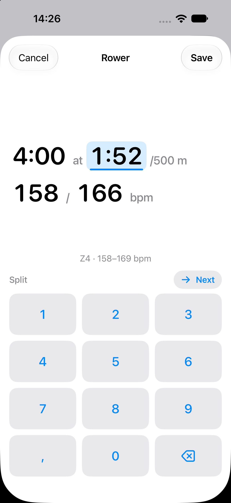 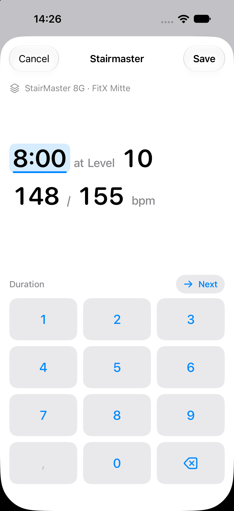

**C** treadmill · rower · fresh

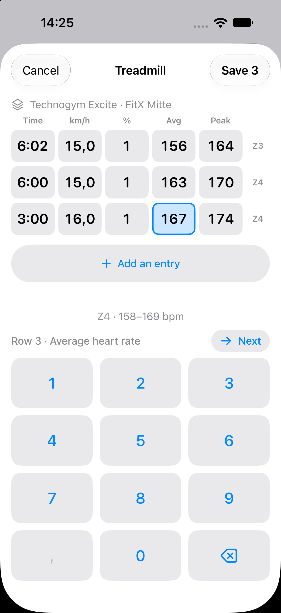 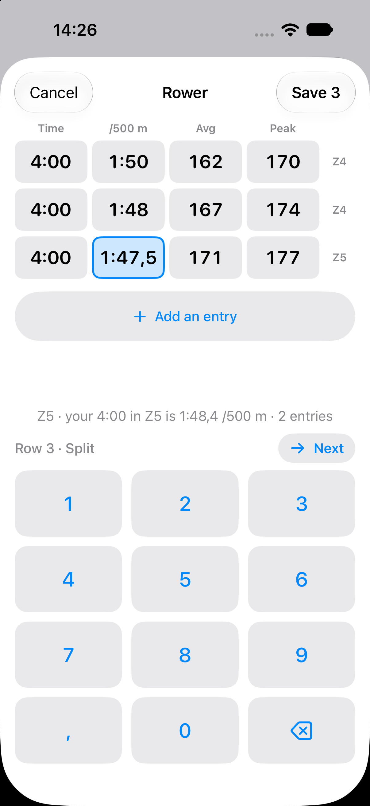 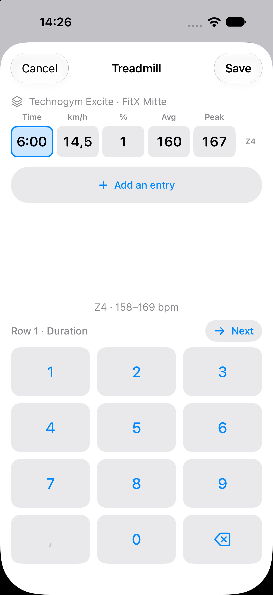

## What the screenshots show

The dev chose C. These are the differences the comparison turned up, not the dev's stated
reasons.

- **Logging after the block is a run of entries.** §6.7 closes the sheet after every
  Save because "sessions are not modelled, so there is no run of entries to batch". For a
  strength entry, typed at the rack, that holds. For an endurance block read off a lap
  list, it does not. A and B cost one sheet open per lap; C costs one per block. C keeps
  §1's rule intact: four laps are four entries, and nothing wraps them once saved.
- **The grid copies the thing you're reading.** Columns in the watch's order, one row per
  lap, so your eye moves down the wrist and down the grid together, and you can see which
  laps are done.
- **Steppers earn nothing when nothing repeats.** With no pattern between intervals, every
  number is a jump, and a jump is keypad distance (§6.2). So C has no steppers, and the
  per-unit stepper sizes the intensity ticket handed on fall away.
- **A runs to five stages** for one treadmill entry, and then repeats them for every lap.
  **B fits an entry on one screen** but still closes after each lap. *Stays open* only
  moves it towards C.

## Round two — C, refined

The dev chose C with the zone line under the grid, and three details were settled:

- **The zone on the bottom line only.** The per-row `Z4` tags are gone, so the grid stays
  a plain copy of the watch. *Against the line* (`your 6:00 in Z4 is 14.6 km/h`) was not
  chosen. The line is a zone and its bpm range.
- **Cancel confirms once anything is typed.** Swipe-down is disabled while the sheet is
  touched.
- **A visible delete on each row**, for a row added one too many, in place of the
  long-press menu. Its column is the one the zone tags gave up. An impossible row now
  outlines its two heart-rate cells in red, so a disabled *Save 5* still points at the row.

A treadmill block of four already fills the grid's space, so it scrolls. The keypad
and the zone line never move.

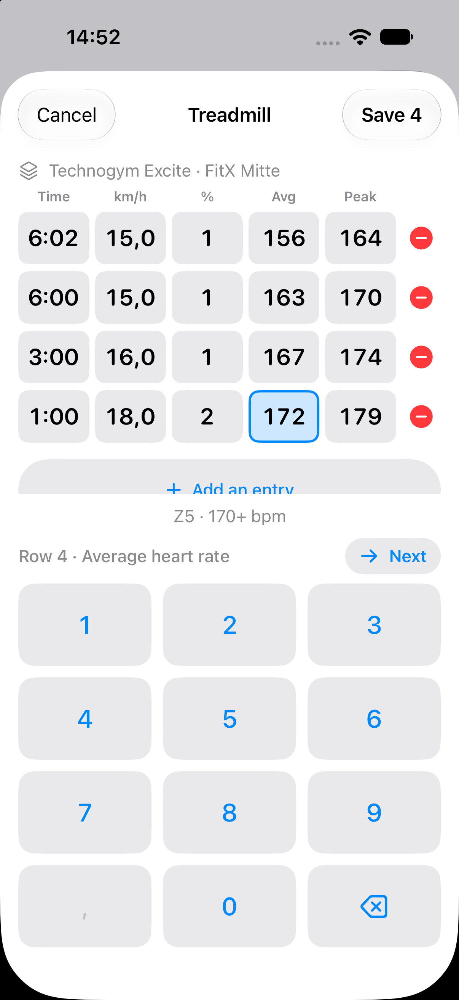 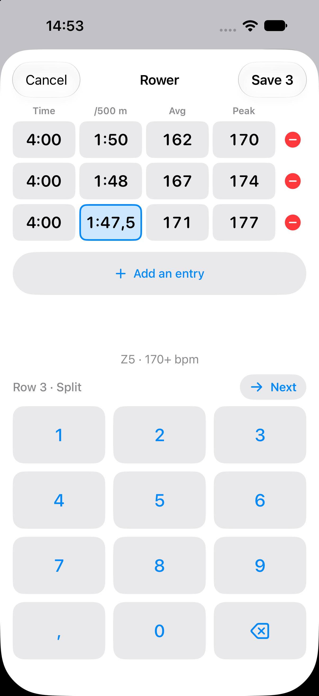 

## Also settled

- **You round as you type.** The watch's lap 2 reads `6:02`. The zone line joins only
  durations typed identically (ADR-0006). The sheet takes duration to the second and never
  snaps it: you know it was a 6:00 rep, so you type 6:00. A `6:02` you do type stands alone.
- **Times fill from the right**, as on a microwave: `6`, `60`, `600` → `6:00`. A split
  takes a tenth after the decimal key: `1:47.5`.

## Still assumed, not decided

- **Editing an entry.** §6.6 reopens the log sheet on a history row. Whether that is C with
  one row, and where the history lives at all, belongs to
  [How is an erg's history reached, and an entry edited?](https://github.com/hermanno3005/Chalk/issues/103).
- **The host screen and the lap list are stubs.** The erg detail screen is
  [How is the derived number presented?](https://github.com/hermanno3005/Chalk/issues/98).
- **The 40–230 bpm bounds block Save** in the prototype, as the zone bounds do on Settings.
