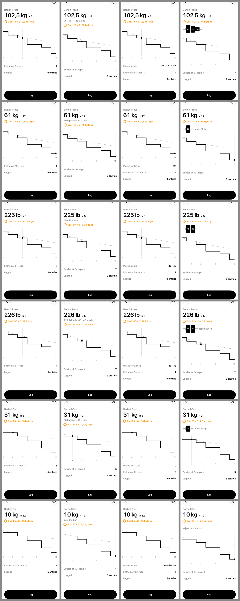

# PROTOTYPE — how does a plate breakdown read under a readout, and does it stay?

Throwaway. Answers [How does a plate breakdown read under a readout, and does it stay?](https://github.com/hermanno3005/Chalk/issues/141),
a ticket on [Map: Store-ready — paying is the only step left](https://github.com/hermanno3005/Chalk/issues/127).

> **Archived.** This write-up and its screenshots live here; the runnable Swift source
> lives at the `prototype-plate-breakdown` tag. See
> [`docs/agents/branch-lifecycle.md`](../../agents/branch-lifecycle.md).

> ## Verdict
>
> **Cut.** Plate breakdown does not ship, and no variant was chosen. The dev's reasons:
> **it is not worth the build**, and **the map is being trimmed**, which is what SPEC §15
> named plate breakdown first for.
>
> The build it would have cost: a stored `bar` on an exercise (a schema bump and a field in
> the backup), a convert rule for it, presets per unit, a *Bar* item at create and in the
> overflow, a Settings switch, and a readout for every case below. All of it is arithmetic
> you already do at the rack.
>
> With it go the **Bar** and **Plate breakdown** terms, the Settings switch, and a convert's
> bar. **Rep-max cards are now the first item cut** if the map grows too big again.

## What was drawn

Identity E's exercise detail screen
([`docs/prototypes/identity/`](../identity/README.md)), the real view, with the breakdown in
three places, against **0 — Off**, which is the screen as it is and what cutting it looks like.

| | Where | Exact | Nearest loadable below |
|---|---|---|---|
| **A** | a grey line between the number and the goal line | `25 · 15 · 1,25 a side` | `60 kg loads: 20 a side` |
| **B** | the first label-and-value row under the chart | `Plates a side  25 · 15 · 1,25` | `Plates for 60 kg  20` |
| **C** | the plates drawn on a sleeve, under the goal line | black plates, each with its number | the same, then `loads 60 kg` |

The bar alone read `Just the bar` in all three. The bar was set from the overflow: *No bar*,
the unit's presets, or a typed weight. The plates were the unit's standard set, biggest first:
25, 20, 15, 10, 5, 2.5 and 1.25 kg, or 45, 35, 25, 10, 5 and 2.5 lb.

Rows, top to bottom, in [`grid.png`](grid.png): bench on a 20 kg bar at 5 reps (`kg`) and at a
typed 61 kg (`kg12`); bench on a 45 lb bar (`lb`); the kg bench after a convert, its bar now
44 lb (`converted`); a curl on a 10 kg bar at 31 kg (`curl3`) and at the bar alone (`curl12`).
Columns are 0, A, B and C.

## What it turned up

These are what the comparison showed, not the dev's stated reasons.

- **On the grid, a breakdown is always exact.** A preset bar on its unit's grid (20, 15 and
  10 kg on 2.5 kg; 45, 35 and 25 lb on 5 lb) makes every weight the steppers reach loadable,
  because the grid is a pair of the smallest plates (§6.2). *Nearest loadable below* only
  appears off the grid: a typed weight, a typed bar, or a convert.
- **A converted bar marks nearly every weight.** §15.2 rewrote a bar like any weight and never
  snapped it to a preset, so `20 kg` became `44 lb`. On a 44 lb bar almost no lb weight loads
  exactly: `226 lb` read `224 lb loads: 45 · 45 a side`. Shipping plate breakdown would have
  meant snapping a preset bar to the other unit's matching preset, or living with that.
- **Cost on screen.** A took one text line. B took one row, and the chart did not give way on
  an iPhone 18 Pro. C took about 40 pt of chart and brought the one non-text element onto a
  screen that otherwise holds a number, a chart and rows. It was the only one readable from
  across the rack.

## Run it

Check out the `prototype-plate-breakdown` tag, open `Chalk/Chalk.xcodeproj` and run. The app is
rooted at `PlateBreakdownPrototypeRoot`: the real exercise detail screen in identity E, over
sample exercises in a scratch store that is wiped on every launch. The black bar below the app
has these controls:

- **‹ ›** switches between 0, A, B and C.
- **scenario pill**: bench on 20 kg → bench on 45 lb → the converted bench on 44 lb → a curl on
  10 kg. Each sets the unit and the bar.
- **appearance pill**: Light → Dark.

The overflow's *Bar* menu sets the bar. Screenshots were launched as
`-prototype.plates B -prototype.scenario converted -prototype.reps 5 -prototype.dark NO` on an
iPhone 18 Pro. The simulator's region writes `102,5`.
